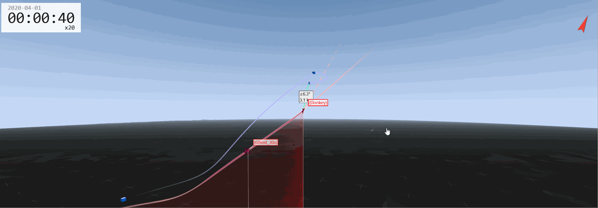
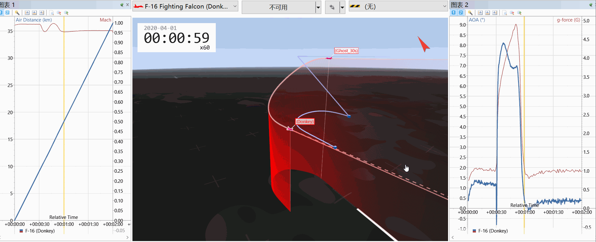
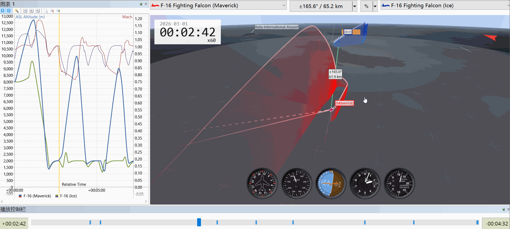
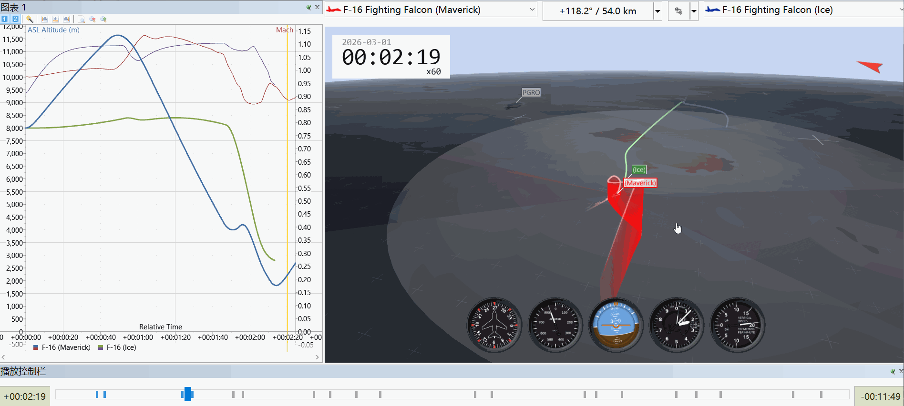
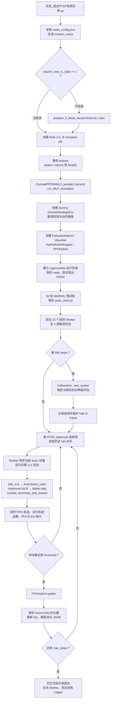
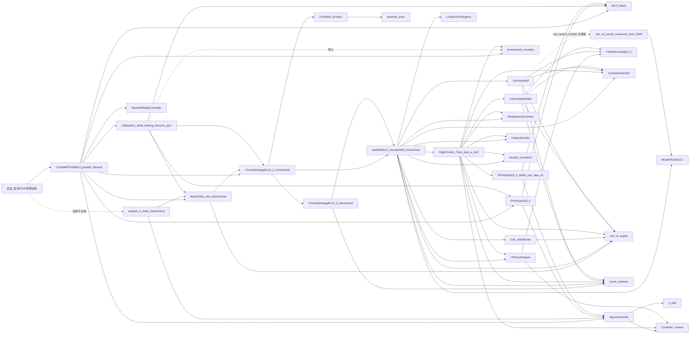

# Fire and Dodge Missile

基于 JSBSim、PyTorch 与混合动作空间 PPO 的 1v1 空战决策项目。主智能体同时输出垂直机动、水平机动和导弹发射动作，通过规则示范数据预训练、并行采样、历史策略自博弈、PFSP 对手采样和 Elo 评分进行训练。

本仓库包含两个相互独立的实验：低层端到端飞行控制，以及高层 1v1 超视距空战自博弈。二者共用同一套 JSBSim F-16 模型、导弹模型、数学计算工具与可视化组件，但训练入口、观测/动作空间和奖励设计不同。第 4～8 节以第二个实验的入口为主线，说明其调用关系。仓库中的同名备份、旧版环境、独立测试和其他算法实验不属于该调用链。
****
## 实验一：基于强化学习的端到端飞行控制器

以 PPO 连续动作策略直接输出 F-16 舵面指令，实现端到端飞行控制；观测与状态归一化由低层 `track_env` 提供。

| 项目 | 内容 |
| --- | --- |
| 入口 | [parallel_FlightControl_Train_dual_a_out2目标会跑.py](TrainAndTests/Controls/parallel_FlightControl_Train_dual_a_out2目标会跑.py) |
| 并行方式 | `torch.multiprocessing` 常驻 Worker + Pipe 同步采样 |
| 动作空间 | 连续动作（`action_dims_dict['cont']`），低层 Actor 来自 [PPOHybrid23_0_distil2_one_step_KL.py](Algorithms/PPOHybrid23_0_distil2_one_step_KL.py) |
| 环境 | [track_env](TrainAndTests/Controls/FlightControl_Train_dual_a_out2.py)，底层飞机为 [UAVmodel6d.py](Envs/UAVmodel6d.py) |
| 启动方式 | `python "TrainAndTests/Controls/parallel_FlightControl_Train_dual_a_out2目标会跑.py"` |

<table>
<tr>
<td align="center"></td>
<td align="center"></td>
</tr>
<tr>
<td align="center">端到端飞行控制效果 1</td>
<td align="center">端到端飞行控制效果 2</td>
</tr>
</table>

## 实验二：1V1 超视距空战自博弈训练

以 PFSP 对手采样、历史策略自博弈和 MARWIL 模仿预训练训练高层空战策略；策略输出垂直/水平机动与开火动作，再经低层 NN 控制器转化为舵面指令。

| 项目 | 内容 |
| --- | --- |
| 入口 | [实验_混合PFSP有预训练.py](TrainAndTests/Combats/实验_混合PFSP有预训练.py) |
| 对手采样 | `PFSP_balanced` + 20% 规则复习 + 历史策略池 + 名人堂 |
| 动作空间 | 混合离散动作（垂直/水平机动 Categorical）+ Bernoulli 开火 |
| 环境 | [ChooseStrategyEnv2_2_hierarchical.py](Envs/Tasks/ChooseStrategyEnv2_2_hierarchical.py) → [battle6dof1v1_missile0309_hierarchical.py](Envs/battle6dof1v1_missile0309_hierarchical.py) |
| 启动方式 | `python "TrainAndTests/Combats/实验_混合PFSP有预训练.py"` |

<table>
<tr>
<td align="center"></td>
<td align="center"></td>
</tr>
<tr>
<td align="center">1V1 超视距空战自博弈效果 1</td>
<td align="center">1V1 超视距空战自博弈效果 2</td>
</tr>
</table>

## 1. 当前实验配置

| 项目 | 当前值或行为 |
| --- | --- |
| 主训练算法 | `PPOHybrid`，混合离散机动动作 + Bernoulli 开火动作 |
| 在线对手采样 | `PFSP_balanced`，以当前主智能体 Elo 为中心进行高斯核采样 |
| 初始对手 | `Rule_0`、`Rule_1`、`Rule_2`、`Rule_3`，初始 Elo 均为 1200 |
| 历史策略 | 开启，精英池最多保留 50 个历史/规则对手 |
| 规则复习概率 | `compete_old_rate = 0.2`，该分支在规则对手间均匀采样 |
| 示范数据 | 使用 `IL_rule = 2` 对应的本地 Rule 2 数据 |
| 预训练 | `IL_epoches = 30`，调用 `PPOHybrid.MARWIL_update` |
| 在线模仿/自模仿 | `alpha_il = 0`、`use_sil = 0`，不启用 |
| 并行采样 | 15 个常驻 Worker，子进程使用 CPU 推理 |
| 周期评估 | 每 50k steps 对 Rule 0～3 测试；随机/确定机动各一组，每组每规则 3 回合 |
| 决策周期 | `dt_maneuver = 0.2 s`，`action_cycle_multiplier = 10`，即每 2 s 决策一次 |
| 动力学步长 | `dt_move = 0.07 s` |
| 场地与回合 | 圆形场地半径 62 km，单回合最长 15 min |
| 训练步数 | `max_steps = 20e6`；达到后允许交互式延长或退出 |
| 训练观测 | `POMDP = 0`；周期评估代码固定使用 `pomdp = 1` |
| 动作 mask | 当前 [mask_config.json](Algorithms/mask_config.json) 为 `ver = 0`、`hor = 0` |
| 续训 | `resume_target_dir = None`，当前从新目录开始训练 |
| 现场生成 IL 数据 | `require_new_IL_data = 0`，当前不调用 `run_rules()` |
| 奖励权重在线调节 | `adj_r_w = 0`，不使用可调开火奖励权重 |
| 设备 | 主进程有 CUDA 时使用 GPU，否则使用 CPU |

> 文件名中的“有预训练”指在线强化学习前执行 30 轮 MARWIL 模仿预训练，不表示入口会通过 `init_model_dir` 加载一个已有的 PPO 模型。

## 2. 项目结构

```text
project03_fire_and_dodge_missile/
├── TrainAndTests/
│   ├── Combats/                 # 实验二入口、训练编排、规则、评估、IL 数据
│   └── Controls/                # 实验一入口、低层飞行控制环境与策略包装
├── Algorithms/                  # PPO、网络头、数学/分布工具、mask 配置
├── Envs/
│   ├── Tasks/                   # 分层动作、观测、终止与奖励
│   ├── battle6dof1v1_missile0309_hierarchical.py
│   ├── UAVmodel6d.py            # 当前空战环境的 JSBSim 飞机模型
│   ├── UAVmodel6d0309.py        # 低层控制环境使用的飞机模型
│   └── MissileModel1112.py      # 三自由度导弹与命中计算
├── Controller/                  # PID、旧飞控网络接口、当前 NN 控制器权重
├── Math_calculates/             # 坐标、角度、大气和场地边界计算
├── Utilities/                   # 观测展平与日志/权重查找工具
├── Visualize/                   # TensorBoard 与 Tacview 支持
├── LaunchZone/                  # 条件式发射区命中概率仿真，已不再被调用
├── logs/combat/                 # 训练运行目录、模型、评分和 TensorBoard 事件
├── docs/                        # README 展示用的实验效果 GIF
└── README.md
```

`Other_tests`、`结果展示`、`废弃代码`、其他 `Combat Test*` 脚本以及算法/环境的备份版本可由各自入口单独使用，但不在本 README 所述入口的依赖闭包中。

## 3. 运行

### 3.1 主要第三方依赖

项目没有统一的依赖锁定文件。该调用链直接使用的主要第三方包包括：

- `numpy`、`torch`、`tensorboard`
- `gym`、`jsbsim`
- `shapely`、`matplotlib`
- `scikit-learn`、`threadpoolctl`、`tqdm`

JSBSim 使用其自带的 `f16` 模型。ONNX 导出所需组件需与当前 PyTorch 版本配套；导出异常会被训练编排代码捕获并打印，不会直接中止后续训练。

### 3.2 启动训练

在仓库根目录执行：

```bash
python "TrainAndTests/Combats/实验_混合PFSP有预训练.py"
```

入口会读取本地配置和 IL 文件，再调用 `run_MLP_simulation()`。达到目标步数后程序会等待输入：直接回车退出，或输入更大的整数步数继续训练。

TensorBoard 可指向本次运行目录，例如：

```bash
tensorboard --logdir "logs/combat"
```

## 4. 从入口开始的执行顺序



### 4.1 入口模块导入阶段就会发生的事情

以下代码位于入口的 `if __name__ == '__main__'` 之外，因此直接运行或导入该入口都会执行：

1. 导入训练编排模块及 `run_rules`。
2. 读取 `Algorithms/mask_config.json`，生成 `PPO0.3_flymask_v{ver}h{hor}` 形式的任务名。
3. 若 `require_new_IL_data = 1`，先现场生成示范数据；当前为 0。
4. 从 `TrainAndTests/Combats/IL/` 加载 Rule 2 的两个 pickle 文件。
5. 将示范动作整理为 `{'cat': ..., 'bern': ...}`，并转换状态和回报的数据类型。

只有入口主程序块内的 `run_MLP_simulation(...)` 才启动正式训练。

### 4.2 单个采样 Worker 内的数据流

1. `worker_process()` 创建 `ChooseStrategyEnv`、当前策略 Actor 和对手 Actor。
2. Master 通过 Pipe 发送 `RUN_EPISODE`、当前权重、对手信息和回合设置。
3. 蓝方由 `HybridActorWrapper.get_action()` 采样；红方按对手类型调用 `basic_rules()` 或历史 Actor。
4. `launch_missile_immediately()` 处理开火，`maneuver14LR()` 把分层动作变成飞行指令，`Battle.step()` 推进飞机与导弹仿真。
5. `combat_terminate_and_reward()` 计算终止与奖励，轨迹按决策周期写入缓冲区。
6. Worker 回传蓝方 PPO 数据、双方附加轨迹和统计指标，随后阻塞等待下一回合。

### 4.3 PFSP、评估与更新的关系

- Master 将精英池和名人堂合并为候选集。20% 概率进入“规则复习”分支；其余情况按 `PFSP_balanced`，根据候选 Elo 与当前主智能体 Elo 的距离计算采样概率。
- 规则对手只需传递规则编号；历史 NN 对手从本次运行目录读取对应的 `actor_rein*.pt`。
- 周期评估与采样都完成后才继续后续流程，评估结果写入 TensorBoard；确定机动测试中若所有规则得分均大于 0.5，则把最新已保存策略加入名人堂。
- 样本达到 `transition_dict_threshold` 后执行 PPO 更新，保存新历史策略并更新 Elo、精英池和续训状态。

## 5. 项目内依赖关系总图

实线表示当前主链或导入依赖，虚线表示当前配置不触发、独立入口或特定方法才会执行的关系。



## 6. 逐文件关系与职责

### 6.1 入口、训练编排、规则与评估

| 文件 | 被谁调用/导入 | 在本调用链中的作用 |
| --- | --- | --- |
| [实验_混合PFSP有预训练.py](TrainAndTests/Combats/实验_混合PFSP有预训练.py) | 用户启动 | 设置全部实验参数，读取 mask 和 IL 数据，调用 `run_MLP_simulation()`。 |
| [CombatPPOWithIL3_parallel_hierarch.py](TrainAndTests/Combats/CombatPPOWithIL3_parallel_hierarch.py) | 入口通配导入 | 核心编排：IL 加载/重构、MARWIL、PPO 更新、并行采样、PFSP/FSP/SP、Elo、精英池、名人堂、续训和检查点。入口实际使用其中的 `cur_dir`、`load_il_and_transitions()`、`restructure_actions()` 和 `run_MLP_simulation()`。 |
| [prepare_il_datas_hierarchical.py](TrainAndTests/Combats/prepare_il_datas_hierarchical.py) | 入口导入 `run_rules` | 用规则双方生成示范轨迹，调用 `compute_monte_carlo_returns()`，写入 IL/transition pickle。当前 `require_new_IL_data = 0`，只导入、不执行生成。 |
| [BasicRules_new_hierarchical.py](TrainAndTests/Combats/BasicRules_new_hierarchical.py) | 训练编排、IL 生成、评估 worker | `basic_rules()` 将结构化态势映射为机动编号与开火意图；`rule3_fire()` 提供专用开火判定。文件尾部的独立规则测试仅在其自身作为主程序运行时执行。 |
| [VsBaseline_while_training_hierarch_plus.py](TrainAndTests/Combats/VsBaseline_while_training_hierarch_plus.py) | 训练编排的测试池 | `test_worker()` 在独立进程创建环境和 Actor，让当前策略分别对抗 Rule 0～3，返回胜负平、得分、回报和双杀统计。 |
| [RewardWeightController.py](TrainAndTests/Combats/RewardWeightController.py) | 训练编排 | `FireRewardWeightController` 保存开火奖励内部/外部权重状态。当前 `adj_r_w = 0`，其 `update()` 未启用，但状态会写入 `special.json`。 |
| [_context.py](TrainAndTests/Combats/_context.py) | 多个模块中的 `from _context import *` | 将仓库根目录加入 `sys.path` 并提供 `project_root`。按本文启动方式，顶层 `_context` 首先解析到入口同目录的这一文件。 |

### 6.2 PPO、网络、工具与日志

| 文件 | 被谁调用/导入 | 在本调用链中的作用 |
| --- | --- | --- |
| [PPOHybrid23_0.py](Algorithms/PPOHybrid23_0.py) | 训练编排、采样/评估 worker | 提供主训练 `PolicyNetHybrid`、`HybridActorWrapper`、`PPOHybrid`；负责混合动作采样、log-prob、GAE/PPO、MARWIL 和可选蒸馏/RND。当前使用 MARWIL、PPO 与 Actor 推理，在线 SIL/ADistill/RND 未由入口启用。 |
| [PPOHybrid23_0_distil2_one_step_KL.py](Algorithms/PPOHybrid23_0_distil2_one_step_KL.py) | `FlightControl_Train_dual_a_out2` | 为低层连续飞行控制器提供另一版 `PolicyNetHybrid`/`HybridActorWrapper`。`Battle` 经该模块间接取得这些类并构建舵面控制 Actor；它不是高层空战 PPO 更新的实现文件。 |
| [MLP_heads.py](Algorithms/MLP_heads.py) | 两个 PPO 文件、训练编排、评估文件 | 提供当前高层 Critic 所需的 `ValueNet(state_dim, hidden_dim)`；文件内其他策略头不是本入口的核心路径。 |
| [Utils.py](Algorithms/Utils.py) | PPO、训练编排、IL 生成 | 提供 `compute_advantage()`、`compute_monte_carlo_returns()`、`SquashedNormal`、梯度范数与 NaN 检查等。当前高层 PPO 使用 GAE 工具，IL/SIL 路径使用蒙特卡洛回报工具。 |
| [rl_utils.py](Algorithms/rl_utils.py) | `Algorithms/Utils.py` | 提供通用 ReplayBuffer、滑动平均和通用训练辅助函数；`Utils.py` 直接导入其中的 `moving_average`、`old_moving_average`。 |
| [tensorboard_visualize.py](Visualize/tensorboard_visualize.py) | 训练编排、低层飞控模块；评估模块仅导入 | `TensorBoardLogger` 封装 `SummaryWriter`，以 `add()` 写标量并可选择启动独立 TensorBoard 进程。当前 `auto_show = False`，只写事件文件。 |
| [mask_config.json](Algorithms/mask_config.json) | 入口与主 `PolicyNetHybrid` | 入口据此命名实验；网络初始化时再次读取并缓存垂直/水平动作映射及 mask 开关。续训时也可从 `actor.meta.json` 推断旧模型配置。 |

### 6.3 分层空战环境与动力学

| 文件 | 被谁调用/导入 | 在本调用链中的作用 |
| --- | --- | --- |
| [ChooseStrategyEnv2_2_hierarchical.py](Envs/Tasks/ChooseStrategyEnv2_2_hierarchical.py) | 训练编排、规则、IL 生成、评估 | 当前实例化的 `ChooseStrategyEnv`。继承 2.0 环境，主要覆写 `combat_terminate_and_reward()`，实现三元组奖励、终止、命中与战果结算。 |
| [ChooseStrategyEnv2_0_hierarchical.py](Envs/Tasks/ChooseStrategyEnv2_0_hierarchical.py) | 2.2 环境 | 继承 `Battle`，定义 1v1 观测键、`obs_1v1()`、`obs2obs_check()`、动作映射 `action_optionsLR` 和 `maneuver14LR()`。 |
| [battle6dof1v1_missile0309_hierarchical.py](Envs/battle6dof1v1_missile0309_hierarchical.py) | 2.0/2.2 环境 | `Battle` 负责红蓝飞机与导弹的创建、物理步进、状态/观测、边界、渲染和开火；`launch_missile_immediately()` 是训练与评估的实际发射入口。 |
| [UAVmodel6d.py](Envs/UAVmodel6d.py) | `Battle` | 当前主空战飞机的 JSBSim 六自由度模型，负责 F-16 加载、状态同步、舵面输入、坐标更新、箔条与导弹对象创建。当前 `Battle.step()` 固定 `e2e = 1`，舵面动作来自 NN 控制器。 |
| [UAVmodel6d0309.py](Envs/UAVmodel6d0309.py) | 低层 `FlightControl_Train_dual_a_out2` | 低层 `track_env` 使用的同系列 JSBSim 飞机模型。主空战 `Battle` 当前明确导入的是 `UAVmodel6d.py`，不要把两者混为同一实例。 |
| [MissileModel1112.py](Envs/MissileModel1112.py) | `Battle`，以及条件式 LaunchZone 模块 | `missile_class` 实现三自由度导弹运动、制导和状态推进；`hit_target()` 负责命中事件计算。其文件尾部的 Tacview 测试只在独立运行时执行。 |
| [calc_hit_points_maneuver_from_RWR.py](LaunchZone/calc_hit_points_maneuver_from_RWR.py) | `UAVmodel6d.can_launch_missile()` 内延迟导入 | 通过 `hit_prob()` 仿真估计发射命中概率。当前训练/评估走 `launch_missile_immediately()`，未调用 `can_launch_missile()`，因此它是条件依赖而非常规每步依赖。 |

### 6.4 低层飞行控制

| 文件 | 被谁调用/导入 | 在本调用链中的作用 |
| --- | --- | --- |
| [FlightControl_Train_dual_a_out2.py](TrainAndTests/Controls/FlightControl_Train_dual_a_out2.py) | `Battle` | 提供 `track_env`。`Battle` 初始化时创建一个实例，物理步进中实际使用其 `scale_state()` 规范化低层控制观测；该文件的独立低层 PPO 训练主程序不会随本入口执行。 |
| [UPolicyWrapper.py](TrainAndTests/Controls/UPolicyWrapper.py) | `Battle` 与低层飞控模块导入 | `UnifiedPolicyWrapper` 把飞行指令转换为 PID 舵面动作，供低层控制训练/教师使用。当前主空战 `Battle.step()` 使用 NN Actor，而非通过该包装器输出动作。 |
| [F16PIDController2_1.py](Controller/F16PIDController2_1.py) | `UPolicyWrapper`、两个 UAV 模型 | 提供 `PositionPID` 和 `F16PIDController`。飞机模型会创建 PID 控制器；但当前 `Battle` 的 `e2e = 1` 分支直接给 JSBSim 输入 NN 舵面动作，因此 PID 的 `flight_output()` 不在该分支中执行。 |
| [Controller_function.py](Controller/Controller_function.py) | 2.2 奖励环境 | 2.2 环境实际使用其中的 `sub_of_radian()` 计算奖励角度。`F16control()` 是另一套旧飞控网络接口，不是当前高层空战动作路径。 |
| [baseline_actor.py](Controller/baseline_actor.py) | `Controller_function.py` | 为旧 `F16control()` 提供 GRU/MLP `BaselineActor`。它在模块导入时被加载定义；只有调用 `F16control()` 时才会进一步读取 `Controller/actor_latest.pt`，当前主链不调用该函数。 |

### 6.5 数学、观测、权重查找与可视化

| 文件 | 被谁调用/导入 | 在本调用链中的作用 |
| --- | --- | --- |
| [CartesianOnEarth.py](Math_calculates/CartesianOnEarth.py) | `Battle`、两个 UAV 模型、低层飞控 | `LLH2NUE()` 与 `NUE2LLH()` 在经纬高和局部北天东坐标之间转换。 |
| [sub_of_angles.py](Math_calculates/sub_of_angles.py) | 规则、`Battle`、UAV、边界工具、低层飞控 | 提供角度差归一化和角度范围转换，如 `sub_of_radian()`、`sub_of_degree()`。 |
| [coord_rotations.py](Math_calculates/coord_rotations.py) | 2.0 环境、`Battle`、UAV、低层飞控 | 提供主动/被动坐标旋转和 `RodRot()`；2.0 环境用 Rodrigues 旋转构造 crank 等机动方向。 |
| [SimpleAeroDynamics.py](Math_calculates/SimpleAeroDynamics.py) | `Battle`、低层飞控 | 提供声速、大气密度、马赫数等通用气动计算函数，经通配导入共享给动力学相关模块。 |
| [Calc_dist2border.py](Math_calculates/Calc_dist2border.py) | `Battle` | `calc_intern_dist2circle()` 计算圆形场地边界距离/左右方向；`polygon_fences` 支持可选多边形场地。本入口 `vertices = None`，使用圆形场地。 |
| [FlattenDictObs.py](Utilities/FlattenDictObs.py) | `Battle`、低层飞控 | `flatten_obs2()` 按指定键顺序把字典观测展平为 `float32` 向量，在 `Battle` 中别名是 `flatten_obs`。 |
| [LocateDirAndAgents.py](Utilities/LocateDirAndAgents.py) | `Battle` 通配导入 | 提供 `get_latest_log_dir()`、`load_actor_from_log()` 等日志和权重查找工具。当前 `Battle` 中相关自动查找代码已注释，NN 控制器路径直接固定为 `Controller/NNController/01.pt`。 |
| [tacview_visualize2.py](Visualize/tacview_visualize2.py) | `Battle`、低层飞控 | `Tacview` 负责实时 socket 遥测，`Tacview_s` 负责静默写 ACMI。训练和测试环境均设置 `tacview_show = 0`，当前主链不启动实时渲染。 |

## 7. 输入资产与输出文件

### 7.1 当前运行所需输入

| 文件 | 读取位置与用途 |
| --- | --- |
| [mask_config.json](Algorithms/mask_config.json) | 入口生成实验名；主 Actor 初始化时确定动作头结构和 mask 行为。 |
| [il_transitions_combat_LR_rule2.pkl](TrainAndTests/Combats/IL/il_transitions_combat_LR_rule2.pkl) | 入口加载并重构，作为 30 轮 MARWIL 预训练数据。 |
| [transition_dict_combat_LR_rule2.pkl](TrainAndTests/Combats/IL/transition_dict_combat_LR_rule2.pkl) | 与 IL 数据一同读取，保留原始 states/actions/next_states/rewards/dones；当前入口没有把它传给 `run_MLP_simulation()`。 |
| [01.pt](Controller/NNController/01.pt) | 每次创建 `Battle`/`ChooseStrategyEnv` 时加载到低层连续控制 Actor，包括 dummy env、采样 Worker 和测试 Worker。 |

若开启 `require_new_IL_data`，`run_rules()` 会重建对应规则编号的两个 pickle。若配置 `resume_target_dir`，训练编排会从指定运行目录恢复模型、优化器、Elo、EMA 和缓冲区状态，并跳过 MARWIL。

### 7.2 新训练运行目录

当前新训练会创建：

```text
logs/combat/PPO0.3_flymask_v0h0-run-YYYYMMDD-HHMMSS/
```

主要产物如下：

| 产物 | 含义 |
| --- | --- |
| `events.out.tfevents.*` | TensorBoard 标量事件，由 `TensorBoardLogger` 写入。 |
| `actor.meta.json`、`critic.meta.json` | 网络参数形状元数据，仅在文件不存在时保存。 |
| `student_actor.onnx`、`student_critic.onnx` | 启动阶段尝试导出的模型；导出失败时打印错误并继续。 |
| `actor_rein0.pt` | 在线训练前的 Actor；当前即 MARWIL 后的策略。 |
| `actor_rein{batch_idx}.pt` | 每次满足更新条件后保存的历史 Actor，也可作为自博弈对手。 |
| `current_actor.pt`、`critic.pt` | 最新训练模型，用于续训。 |
| `optimizers_state.pt` | Actor/Critic 及可选 RND 优化器状态。 |
| `il_buffer.pt` | IL/自模仿缓冲区；当前因存在预训练阶段而创建并保存。 |
| `elo_ratings.json` | 全量 Elo、当前主智能体分及最近更新步数/批次。 |
| `elite_elo_ratings.json` | 当前精英池快照。 |
| `hall_of_fame.json` | 通过周期评估筛选的名人堂策略。 |
| `Elite_Fire_Stats.json` | 对手和主智能体的开火/导弹期统计。 |
| `special.json` | 开火指标 EMA 与 `FireRewardWeightController` 状态。 |
| `fire_records_buffer.pkl` | 仅 `use_supervised_fire = 1` 时保存；当前入口未开启。 |

开启 Tacview 静默记录时，ACMI 文件另写入根目录 `acmi_records/`；当前训练与评估配置不生成该目录中的实时记录。

## 8. 阅读源码的建议顺序

1. 从 [入口脚本](TrainAndTests/Combats/实验_混合PFSP有预训练.py) 确认实验参数。
2. 阅读 [训练编排](TrainAndTests/Combats/CombatPPOWithIL3_parallel_hierarch.py) 的 `run_MLP_simulation()` 和 `worker_process()`。
3. 阅读 [主 PPO](Algorithms/PPOHybrid23_0.py) 的 `PolicyNetHybrid`、`HybridActorWrapper`、`PPOHybrid.update()` 与 `MARWIL_update()`。
4. 沿 [2.2 奖励环境](Envs/Tasks/ChooseStrategyEnv2_2_hierarchical.py) → [2.0 分层环境](Envs/Tasks/ChooseStrategyEnv2_0_hierarchical.py) → [Battle](Envs/battle6dof1v1_missile0309_hierarchical.py) 理解观测、动作、奖励和物理步进。
5. 最后查看 [当前 UAV 模型](Envs/UAVmodel6d.py)、[导弹模型](Envs/MissileModel1112.py) 与 [低层飞控环境](TrainAndTests/Controls/FlightControl_Train_dual_a_out2.py)。

这条顺序能把“训练算法”和“环境物理”分开，也能避免误把低层控制器使用的 `PPOHybrid23_0_distil2_one_step_KL.py` 当成高层空战训练所更新的 PPO 文件。
